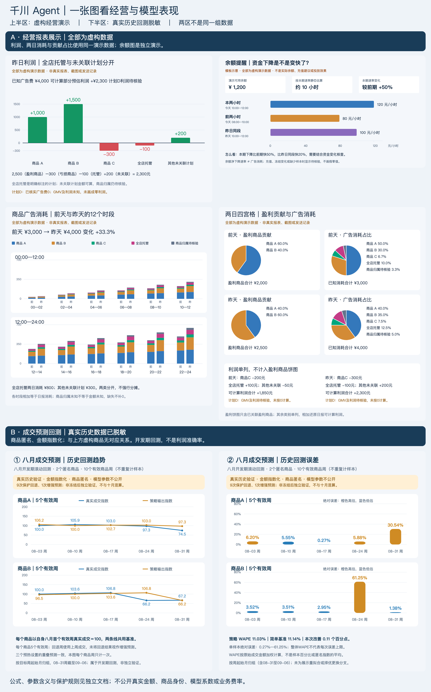
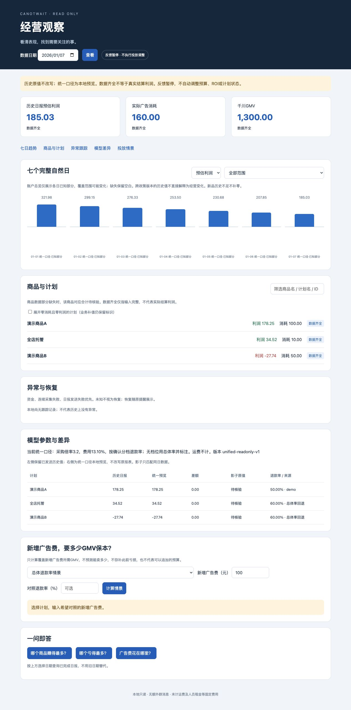

# Qianchuan Agent | Understand performance before acting

[简体中文](README.md) · **English**

Less reporting work. A clearer view of profit, spending, balance, and priorities.

The assistant analyzes and alerts; media buyers decide. It does not automatically change budgets, ROI targets, or campaign status. Estimated profit is not final accounting profit.

## What it provides

| Business need | Output |
| --- | --- |
| Review results | Estimated profit, profit/loss priorities, spending and contribution shares |
| Track changes | Two-day product and time-slot spending, seven-day trends, balance depletion rates |
| Check details | Local dashboard, campaign Excel files, and questions about yesterday |
| Follow up gaps | Pre-delivery checks, missing-data labels, rechecks and recorded differences |

Similar rule alerts are grouped. Uncertain delivery is checked before retrying. Original reports remain unchanged; local backfills and reviewed results are labeled separately.

## Chart overview

The upper section contains fictional business demos. The lower section contains anonymized historical backtests. They are separate datasets. Chart labels are in Chinese; click to enlarge.

August covers two products and ten valid product-weeks: WAPE 11.03%, versus 11.14% for the baseline; nine fallbacks and one enhanced prediction. Weeks are grouped by start month, including August 31–September 6. August was selected after comparing available months. This development-period result is not independent validation, a future error guarantee, or a measure of profit accuracy.

[Formulas and decision rules — Chinese](docs/model-rules-sanitized.md) disclose structure and meanings while keeping sensitive parameters private.

## Daily use

- **10:00 report:** guide → all profit and supplementary pages → Excel → two-day spend and contribution charts. A date notice precedes the package, with one native mention.
- **Even-hour balance updates:** balance and depletion speed; rule-based warnings at RMB 500 or below.
- **On demand:** use the local dashboard or the existing Chinese commands to ask which products earned or lost most yesterday and where spend went.

All times are Beijing time; local authorization and configuration are required. Balance alerts run separately; two-day charts are not resent at midnight.

## Local business dashboard

Choose a date, review seven-day trends, expand products and campaigns, and compare profit estimates and spending scenarios. Missing values are not zero. Backfill sources and unsent status stay visible.

## Limits and next steps

| Current boundary | Remaining work |
| --- | --- |
| Profit uses confirmed assumptions and excludes shipping and fixed costs | Reconcile actual refunds, fees and accounting results |
| Totals include calculable amounts; business-rule estimates are labeled | Resolve livestream and historical attribution gaps |
| Attribution and amounts are assessed separately; managed and unlinked campaigns remain separate | Continue coverage and consistency checks |
| Feedback is paused; media buyers execute changes | Track adoption, advertising outcomes and time savings |

Code capability is not deployment or acceptance evidence. Backtesting is not proof of revenue improvement. Automatic actions require separate authorization and acceptance.

[Detailed business and verification notes — Chinese](docs/homepage-details.md) · [Sanitized model rules — Chinese](docs/model-rules-sanitized.md)

Presentation updated November 12, 2026. Enablement and actual delivery depend on runtime records and acceptance evidence.
