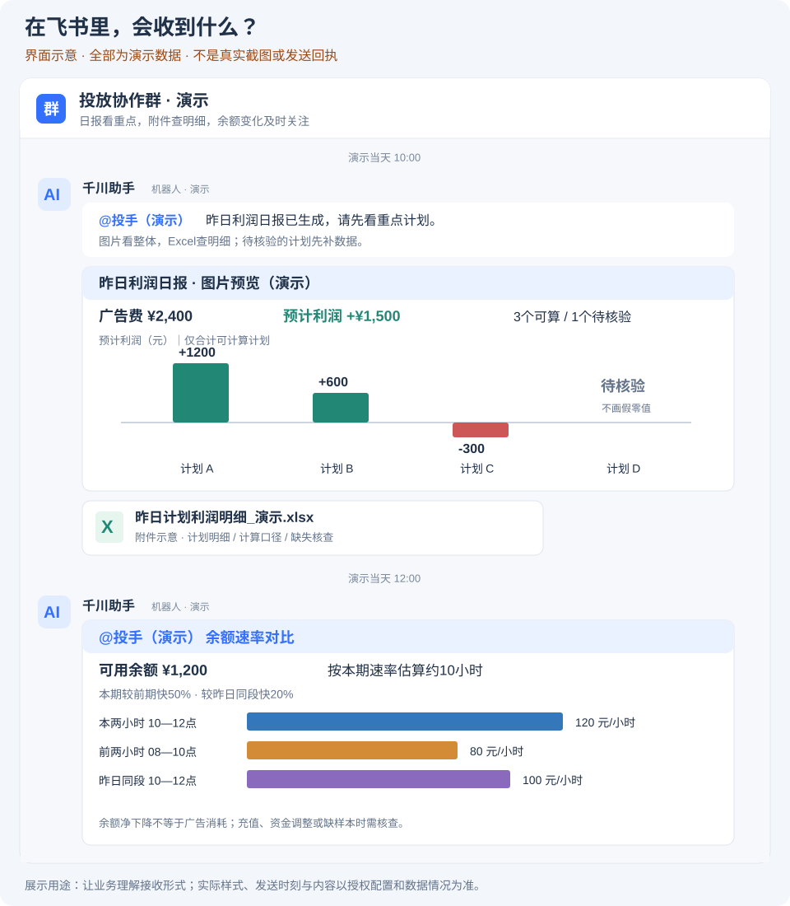
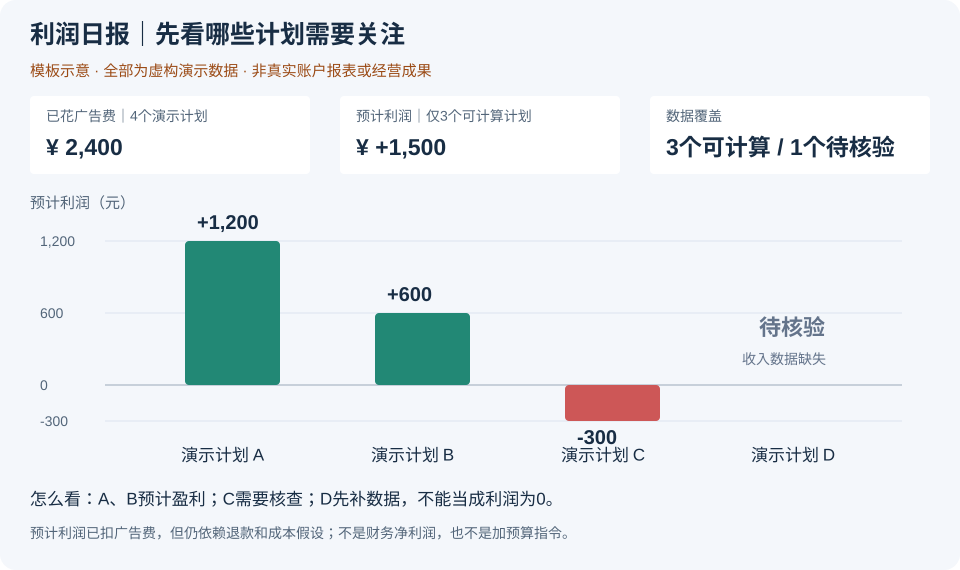
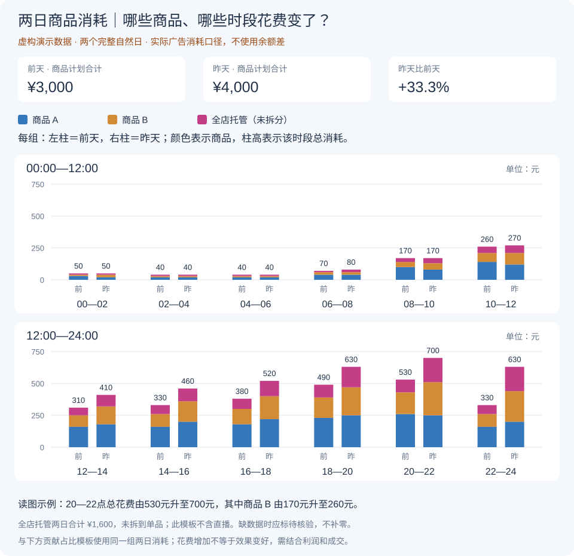
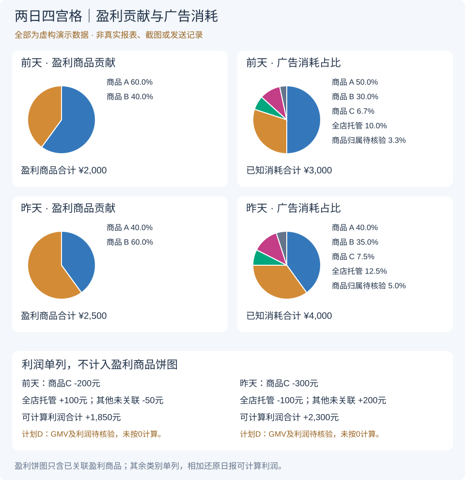
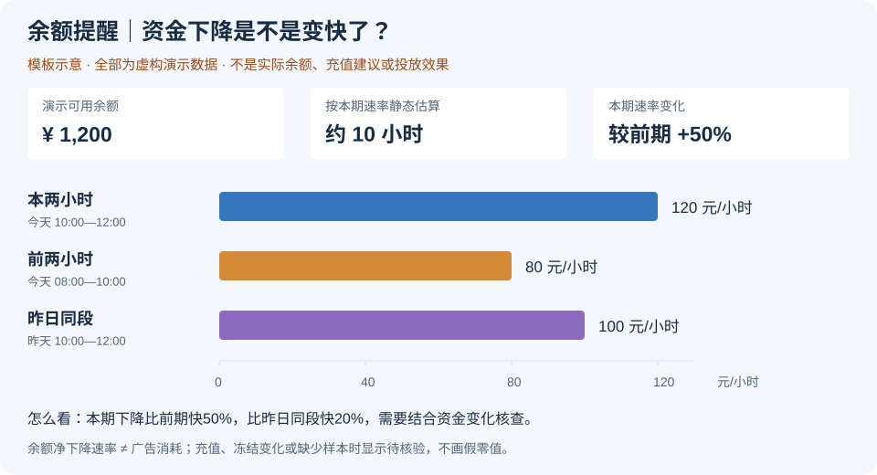

# 千川 Agent｜看清投放，再做判断

**每天少整理报表，更快看清：赚不赚钱、钱花在哪、余额够不够。**

助手分析和提醒，投手决定怎么调整。**当前不自动改预算、ROI或暂停计划。**

## 现在能做什么？

| 业务要看什么 | 助手怎么帮 |
| --- | --- |
| 盈利情况 | 利润图看重点，Excel查明细 |
| 钱花在哪 | 对比两天各商品、各时段的消耗 |
| 花费是否值得 | 并排看盈利贡献与广告费占比 |
| 资金变化 | 对比本两小时、前两小时和昨日同段 |
| 数据有何变化 | 提醒计划、指标、前后数值和时间 |
| 历史情况 | 按账户和日期查报告，缺失明确说明 |

两日对比随原 **10:00日报**发送，余额提醒按原时段运行；需先完成本地授权和配置。

## 自动发送时间与内容

以下均为北京时间（`Asia/Shanghai`），需本地启用相应功能；不是每次采集都发消息。

| 时间或触发条件 | 文字 | 图片 | Excel |
| --- | --- | --- | --- |
| 每天10:00日报 | 简短日期提示，真实@投手一次 | 每日三件事导读图在首位，随后昨日利润图（可能多页）、两日消耗对比图、四宫格贡献占比图 | 昨日逐计划利润明细 |
| 每个偶数整点：00:00、02:00…22:00 | 10:00、12:00、14:00、16:00、18:00卡片内真实@投手；其他时段正常不@ | 余额、估算可用时长，以及本两小时/前两小时/昨日同段速率对比 | 无 |
| 余额不高于500元时 | 简短低余额预警，真实@投手；同一预警状态去重 | 非定时时点用文字卡片，定时时点可合并到余额图 | 无 |
| 半小时监测发现符合提醒条件的异常时 | 具体计划、指标变化、退款提示或数据缺失；文字卡片 | 无独立图片 | 无 |
| 持续采集/服务故障或恢复时 | 故障、数据缺口、日报延迟或恢复说明；文字卡片 | 无独立图片 | 无 |

**凌晨不再单独发送两日对比图或四宫格。** 两张图只随10:00日报发送，使用前两个完整自然日（D−2、D−1）；00:00只保留正常余额提醒（不@投手）及按条件触发的异常提醒（保留@）。10:00余额提醒与日报用途不同，仍各自保留。

日报重试窗口为10:00（含）至12:00（不含），已确认发送的部分不重复发送；结果未知时先核实。小时采集只采集，日报解读和指定日期日报仅在用户请求时回复，不额外定时发送。反馈继续暂停，不自动调整预算、ROI或计划状态。

详细发送、去重和缺失处理见[自动日报与提醒规则](docs/automatic-profit-daily.md#现行自动发送清单)。

## 还差什么？

| 下一步 | 当前状态 |
| --- | --- |
| 核对最终利润 | 还需实际退款、费用和财务数据 |
| 跟踪建议效果 | 反馈暂停，采纳与效果跟踪未完成 |
| 开放自动操作 | 仍需授权和单独验收 |
| 量化业务价值 | 持续记录稳定性、使用情况与节省工时 |

预计利润不是最终财务利润；净成交减少也不等于已确认退款。目前不宣称收益提升。

## 看展示模板

**全部使用虚构数据，非真实截图或发送记录。** 图片直接展示，手机上点击可放大查看。

### ① 飞书里收到什么？｜查看完整接收流程

简短日期＋一次@投手 → 每日三件事导读图 → 利润图与Excel → 两日消耗与贡献图；余额提醒另按时段发送。

### ② 利润图｜哪些商品需要关注？

零线上方盈利、下方亏损；颜色表示商品。待核验不填零，合计只含可计算部分。

### ③ 两日消耗图｜哪些商品、哪些时段花费变了？

每组左前天、右昨天；同商品同色、刻度一致。花费增加不代表效果变好。

### ④ 贡献占比图｜花钱与盈利贡献是否匹配？

左看盈利贡献，右看消耗占比。亏损、托管利润和缺失另列，不计入盈利饼图。

### ⑤ 余额提醒｜资金下降是否加快？

三时段统一刻度，估算时长假定速度不变。余额下降不是广告消耗；缺样本或资金调整时需核查。

[演示数据与颜色对照](docs/demo-guide.md) · 商品颜色固定；余额图颜色仅代表时段。

## 继续了解

- **业务说明：** [日报与提醒](docs/automatic-profit-daily.md) · [利润计算](docs/current-profit-rules.md)
- **项目过程：** [开发历程](docs/development-journey.md)
- **开发维护：** [开发者说明](docs/developer-guide.md) · [数据保护](SECURITY.md)

更新依据：2026-11-06，功能代码 `7588c65`。代码已接入不等于所有环境均已启用。
