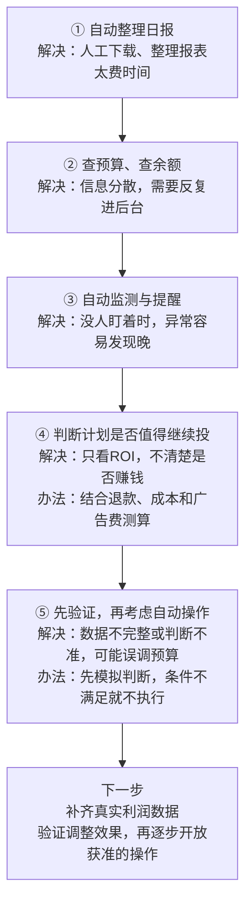
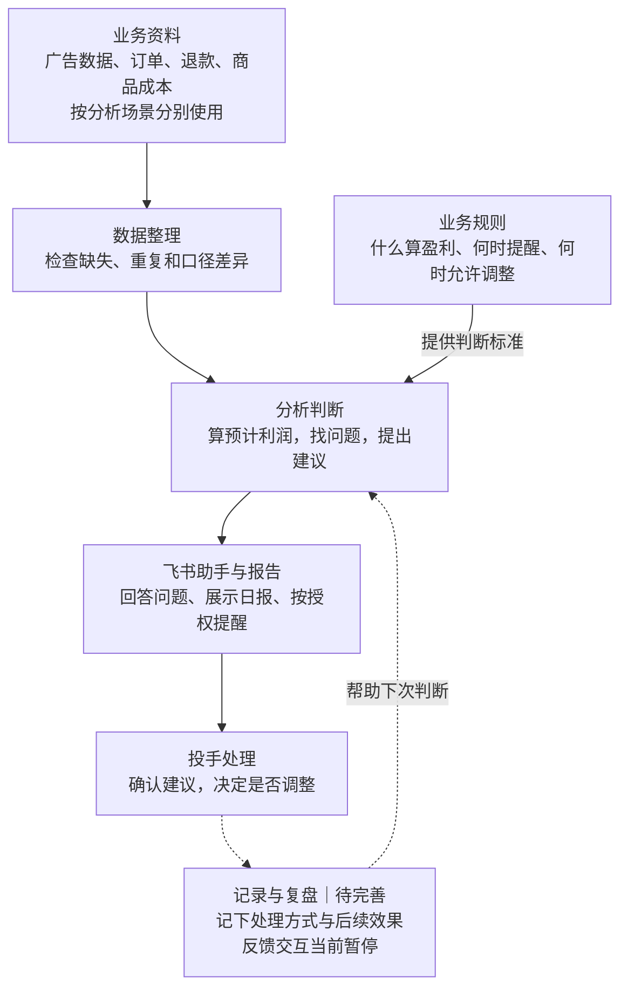

# 千川 Agent｜让投流判断更有依据

自动利润日报接入说明：[每日图片、Excel、@投手与发送去重](docs/automatic-profit-daily.md)。启用依赖本地配置，真实账号、经营数据及群聊人员信息不随代码发布。

把分散的广告数据整理成看得懂的报告，结合退款和成本测算预计利润，帮助投手更快发现问题、判断下一步，并为后续复盘留下记录。

项目从一个简单需求开始：**每天下载报表、整理数据、查看计划和检查余额，能不能让助手先做起来？** 随着开发推进，我们发现，真正有价值的助手还需要说清楚：数据是否完整、利润怎么算、建议依据是什么，以及现在为什么可以操作或应该等待。

> **当前定位：投流分析与决策辅助。** 已形成数据查询、报告、监测、利润估算与规则验证能力。当前业务流程不自动调整预算、修改ROI或暂停计划；反馈交互当前暂停。仓库中的功能代码不等于已部署到运行服务，利润预测也不等于实际结算利润。

## 这个项目有什么用？

| 日常业务中的问题 | 助手提供的帮助 | 希望带来的价值 |
| --- | --- | --- |
| 每天花很多时间整理数据 | 汇集广告信息，生成日报和查询结果 | 把时间留给判断和处理问题 |
| 成交和ROI不错，但不知道赚没赚钱 | 结合退款假设、商品成本和费用测算预计利润 | 更接近经营结果地看投放 |
| 账户和计划多，异常容易发现晚 | 持续采集，检查余额、数据更新和异常情况 | 减少人工反复盯盘 |
| 不同人对同一计划判断不一致 | 明确判断条件，保留数据范围和计算依据 | 让讨论有共同标准 |
| 建议提出后，处理过程难追踪 | 保存建议与反馈，为后续复盘提供资料 | 逐步形成可追溯的工作流程 |

以上是项目要解决的问题和目标价值。实际节省工时、建议采纳率和利润改善，还需要持续记录与验证，目前不宣称已经实现稳定增收。

## 开发是怎样一步步推进的？

下面是业务视角的简化流程。早期数据接入和素材日报属于相关基础积累，后续逐步发展成独立的千川助手；各阶段存在交叉。



### 第一阶段：先把重复工作整理成流程

最初希望助手能整理日报、提醒余额、找出需要关注的计划，并记录投手的处理结果。

遇到的问题是，查询数据、提出建议和直接操作账户，需要的条件完全不同。因此先从只读分析做起，让人确认判断，再逐步增加能力。这一步明确了方向：先帮助投手工作，再验证哪些环节适合自动化。

### 第二阶段：接入数据，先把数字弄明白

逐步接入账户授权、广告报表、成交和素材数据。真正的难点是不同报表的统计范围、金额单位和指标口径不一致；接口没有返回记录，也不一定代表实际为零。

解决办法是把财务核对、计划表现和素材归因分开看，检查查询范围和分页完整性，并分别记录真实零值、缺失和失败。只有取得明确证据，才把相应指标认定为零，不能由“没有消耗”继续推断“没有成交”。

### 第三阶段：做出能使用的日报和飞书助手

从真实导出表开始，整理计划表现、计算预计利润，再通过飞书提供报告和查询。

这一阶段发现了部分日混入完整日、成本倍率与ROI混淆、退款可能重复扣减等问题。处理方式是逐项拆开公式：原始指标保留原值，历史假设单独说明，数据不全就标记待核验。报告开始能够支持日常讨论，但预测结果仍不能代替结算结果。

### 第四阶段：从看文件，发展到查询当前账户

接入真实日报、当前预算和账户余额，增加指定日期查询、计划诊断和业务问答。

随之遇到授权过期、接口超时、消息重复发送和账户资料串用等问题。开发补充了授权管理、有限重试、发送进度保存、访问范围限制和账户隔离；大账户保留完整数据，消息里展示摘要，避免一次返回过多内容。

### 第五阶段：让助手持续工作，并能发现自身异常

增加定时快照、小时报表、余额监测、异常记录和健康检查。

持续运行后发现，程序还开着不代表采集正常，两次累计数字的差值也不一定就是这段时间真实发生的业务。因此开始检查数据更新时间、采集进度和时间范围，并补充日志、升级核验与回滚能力。历史部署和采集已有证据，长期稳定性仍需持续观察。

### 第六阶段：把投手经验变成明确条件

“这个计划不错，可以考虑加预算”需要进一步拆解：看几天、怎样算盈利、数据缺失怎么办、余额不足怎么办、刚调整过是否还能再调？

项目逐步整理了盈利质量、观察周期、余额保护、调整间隔和审批等条件。代码负责计算与检查，大模型负责解释和复盘，不能自行更改业务阈值。规则与执行组件的实现，为后续受控操作做准备，不代表当前已开放自动投放。

### 第七阶段：用真实数据做影子验证

“影子验证”就是先让系统跑判断，记录它会建议什么、为什么，再检查能否用于真实操作。

实际发现了历史缺行、成交与订单修订、查询指标不同导致返回记录不同等问题。通过补采、对账、修订审核和证据回放逐项处理；不满足条件时保留阻断原因。一个计划通过盈利检查，也不代表所有操作条件都已满足。

### 第八阶段：补利润分析、反馈记录和规范交付

利润分析逐渐发展为两条独立路径：一条使用千川计划数据和已确认的业务假设进行情景估算；另一条保留订单、退款及成本导入核算。两者不混算。实际广告费与按比例估算广告费也分别计算，避免重复扣费。

同时补充了建议编号、投手反馈和只读预算核验，并整理脱敏代码、测试与交接说明。反馈功能当前暂停交互，完整的效果回收仍待完善。代码备份与本地运行配置分开管理，方便维护，也避免把真实经营资料带入仓库。

## 整个项目怎样配合？

可以把它理解为下面这套工作流程。图中的反馈与复盘是建设方向，完整闭环尚未启用；报表发送和提醒以实际配置、授权及运行状态为准。



对应到项目资料，主要分为以下几部分：

| 部分 | 业务上负责什么 | 文件位置 |
| --- | --- | --- |
| 日常助手 | 接收查询、采集数据、组织报告和消息 | `agent-runtime/` |
| 分析与验证 | 检查数据、测算利润、验证规则和操作条件 | `qianchuan-shadow/` |
| 业务规则与说明 | 解释怎么算、怎么用、哪些条件尚未满足 | `docs/`、本页及各模块说明 |
| 测试与维护 | 验证计算、异常处理和版本改动 | 各模块的 `tests/`、`tools/` 及根目录 `scripts/` |
| 真实业务资料 | 提供配置、订单、报表、运行记录和证据 | 仅在本地独立保管，不随仓库发布 |

## 现在做到哪里，还差什么？

| 方向 | 已有基础 | 接下来要补的工作 |
| --- | --- | --- |
| 看数据 | 查询、日报、快照和缺失检查 | 继续完善覆盖范围、稳定性和异常恢复 |
| 看利润 | 计划情景估算与独立订单核算 | 补齐订单归因、成熟退款、真实成本及财务核对 |
| 给建议 | 明确规则、保存证据、说明阻断原因 | 验证建议是否被采用、是否真正有效 |
| 做操作 | 具备部分审批与执行组件 | 完成明确授权下的小范围端到端验收；当前不自动操作 |
| 做复盘 | 已开发反馈记录和只读核验 | 反馈交互当前暂停，自动效果回收尚未启用 |
| 证明价值 | 有真实数据分析与使用记录 | 量化节省工时、使用频率、建议采纳率和经营效果 |

项目当前最重要的进展，是把“凭经验看计划”逐步变成“有数据、有规则、能解释、可追查”的工作方式。接下来的重点，是证明这套方式能稳定帮助业务，而不仅是继续增加功能。

## 进一步了解

- [现行利润规则、输出与核查](docs/current-profit-rules.md)：了解当前使用什么数据、怎么算、结果有哪些限制。
- [投手反馈闭环第一期](docs/feedback-phase1.md)：了解已开发的反馈与核验能力；当前状态以现行规则中的暂停说明为准。
- [脱敏与验证记录](SECURITY.md)：了解代码交付范围及历史验证情况。

<details>
<summary>开发者说明：数据边界、本地验证与提交检查</summary>

### 数据边界

本仓库不包含真实密钥、群及人员标识、订单、广告报表、生产成本配置、数据库、执行证据或历史经营报告。示例账号、商品标识和示例退款率不能用于真实经营决策。

`.env`、`rules.json`、利润配置、审批身份和控制文件需在本地单独提供。不要直接用脱敏副本覆盖正在运行的程序；代码更新不代表生产部署。

### 本地验证

Python 3.12+。分别安装 `agent-runtime/requirements.txt` 和 `qianchuan-shadow/requirements.lock` 所列依赖。部分验证依赖本地测试配置或专门夹具，运行前请查看对应模块说明。

```sh
cd agent-runtime
python -m unittest discover -s tests
cd ../qianchuan-shadow
PYTHONPATH=src python -m unittest discover -s tests
```

### 提交检查

安装 Gitleaks 后运行 `gitleaks dir . --redact=100`，并核对 `git diff --cached`。`.gitignore` 不会清除已跟踪文件，也不能代替敏感信息扫描。

运行 `git config core.hooksPath .githooks` 启用本地推送检查。推送前会检查敏感路径并扫描提交历史；未安装 Gitleaks 时会停止推送，可通过 `GITLEAKS_BIN` 指定安装位置。

</details>
