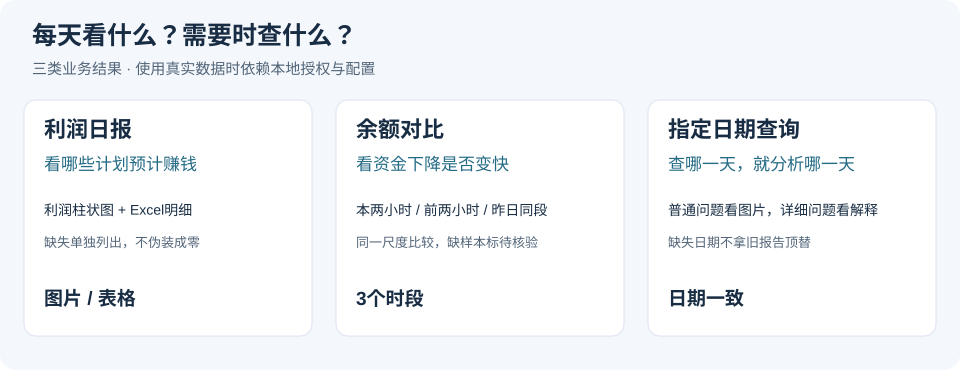
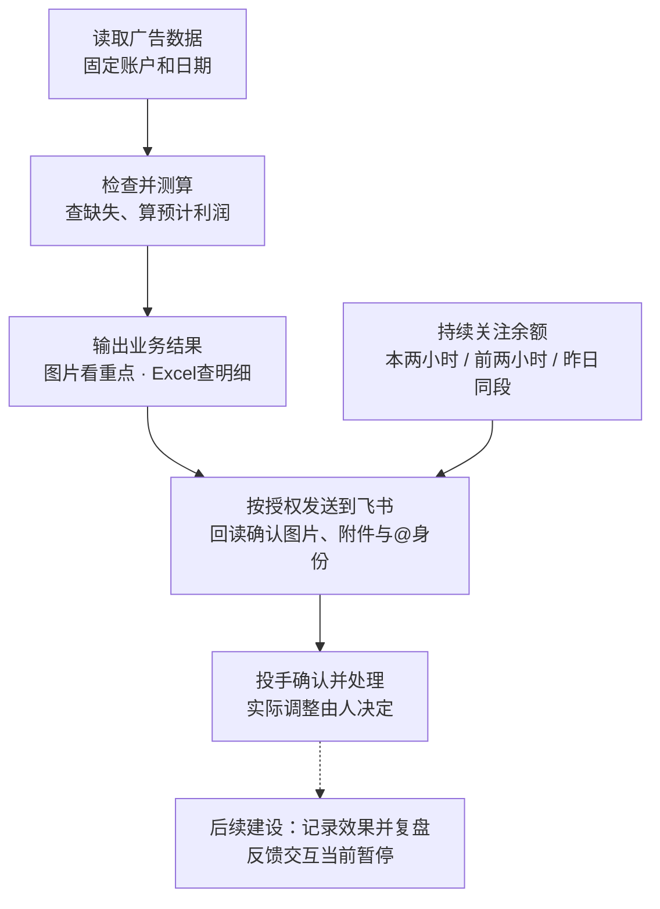
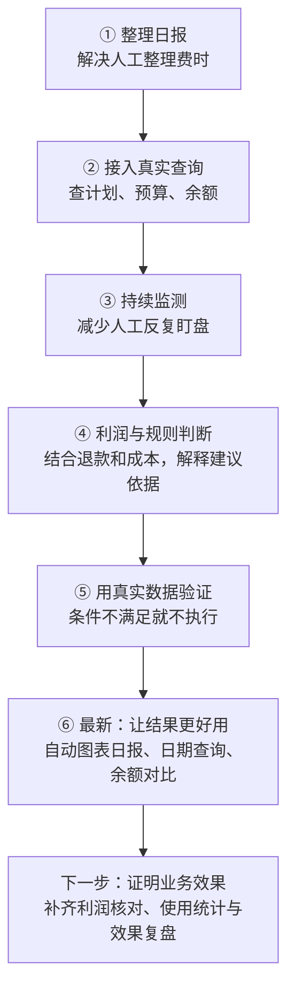

# 千川 Agent｜每天看清投放，调整更有依据

**每天有哪些计划预计赚钱？广告费花在哪里？账户余额下降得快不快？**

千川 Agent 把广告数据整理成图片、表格和简短解释，让投手少做重复整理，让业务负责人更快看到需要关注的问题。计算有依据，缺失会说明，历史判断可以追查。

> 当前是**分析与决策辅助工具**：支持按授权运行的自动利润日报和余额提醒；不自动调整预算、修改ROI或暂停计划。反馈交互当前暂停。预计利润属于业务假设下的测算，不是公司财务净利润。



## 一眼看懂：业务能拿它做什么？

| 业务问题 | 现在怎样看 | 带来的帮助 |
| --- | --- | --- |
| 昨天哪些计划值得重点看？ | 利润柱状图，区分预计盈利、亏损和待核验 | 先找重点，再查明细 |
| 具体数字怎么算出来的？ | Excel列出消耗、利润测算、口径与缺失核查 | 结果能核对，讨论有依据 |
| 手机里不想看一大段报告 | 一张摘要图：结论、预计利润、广告费和重点计划 | 快速掌握重点，详细问题再展开 |
| 余额下降是不是变快了？ | 对比本两小时、前两小时、昨日同段 | 看近期变化，并参考可用余额和估算时长 |
| 想回看指定日期 | 按账户和日期查新版报告，必要时只读生成历史日报 | 查哪天就是哪天，不拿旧数据替代 |
| 消息到底有没有发成功？ | 分段记录，回读图片、附件和@身份 | 有依据确认送达；结果不明时停止盲目重发 |

**价值目标：减少整理时间，让异常更早被看见，让投放讨论更有依据。** 节省了多少工时、提高了多少利润，目前还缺持续量化数据，不展示虚构收益。

## 解决了什么，现在能做什么，还差什么？

核对日期：**2026-11-06**。“现在能做”描述已有能力，实际启用仍依赖本地授权、配置和运行环境。

| 过去的业务困扰 | 现在能做什么 | 还需要什么 |
| --- | --- | --- |
| 每天手工整理、发送日报 | 按原任务输出摘要、利润图片和Excel，按授权发送到飞书 | 持续观察送达与异常恢复，记录实际节省工时 |
| 只看ROI，不清楚赚没赚钱 | 结合退款和成本假设看预计利润，区分盈利、亏损、未知 | 补齐成熟退款、真实费用和财务核对 |
| 长报告看不完，重点不突出 | 一张手机摘要图先看结论，Excel再查明细 | 继续收集投手使用反馈 |
| 余额只剩一个数字，不好判断变化 | 同时看本两小时、前两小时和昨日同段的下降速率 | 资金变化或采样不全时仍需核查 |
| 查询历史日期，容易混入旧报告 | 固定账户、日期与报告版本，缺失明确提示 | 对缺失日期补齐可核验资料 |
| 消息发没发到、数据是不是零，说不清 | 发送后回读确认；缺失与已证实零值分开展示 | 结果不明时需要人工核对，不盲目重发 |
| 有建议，但不知道后来效果如何 | 已有建议记录和只读核验能力 | 反馈交互当前暂停，采纳率与效果复盘仍待闭环 |
| 希望直接自动调整投放 | 已有规则判断和部分执行组件 | 当前仍由人决定；自动操作需要另行授权和实际验收 |

## 看看业务实际会收到什么

**下面是展示模板，全部使用虚构计划与演示数字。** 用于说明报表长什么样、应该怎么看，不是线上截图、真实经营数据或收益承诺。实际输出以当前配置、数据覆盖和报告日期为准。

### 模板一：利润柱状图——哪些计划值得重点看？


| 图里看到什么 | 业务上怎么理解 |
| --- | --- |
| 绿色柱在零线上方 | 在当前退款和成本假设下预计盈利，仍要结合样本和后续退款看 |
| 红色柱在零线下方 | 优先检查成本、退款、成交和消耗，不等于系统会自动停投 |
| “待核验”没有柱子 | 数据不够，暂时不能下利润结论；不是利润为零 |
| 可计算部分利润合计 | 只代表数据足够的计划，不能冒充完整账户利润 |

模板中四个计划的广告费合计为演示值2,400元；只有三个计划能算利润，合计1,500元。第四个计划收入缺失，所以不进入利润合计。真实日报会在Excel中保留逐计划明细、计算口径和缺失项。

### 模板二：余额速率对比——是否需要更关注账户资金？


| 图里看到什么 | 业务上怎么理解 |
| --- | --- |
| 本两小时比前两小时的条更长 | 最近资金下降加快，应结合账户变化核查 |
| 与昨日同段对比 | 看相同时段是否出现明显变化 |
| 可用余额与估算时长 | 帮助安排资金关注优先级；时长是假定速率不变的静态估算 |
| 缺样本、充值或冻结变化 | 无法可靠比较时标待核验，不强行画成零 |

演示中1,200元余额除以每小时120元，得到约10小时；速率变化后，估算也会变。**余额净下降不是财务广告消耗，不能直接拿来算利润。**

### 模板三：飞书接收效果——日报和余额提醒直接看


这张图把业务接收过程放在一起：**先收到@提醒和日报图片，需要核对时查看Excel，之后按配置收到余额对比提醒。** 群名、投手、计划和金额均为虚构演示内容，界面是简化示意，不是真实飞书截图或已送达证明。

| 在群里收到什么 | 业务人员可以怎么用 |
| --- | --- |
| 日报摘要与利润图片 | 先看预计盈利、亏损和待核验计划 |
| Excel附件 | 核对逐计划明细、计算口径及缺失项 |
| 余额三时段提醒 | 比较资金下降速度，结合余额安排关注优先级 |

展示沿用前两张模板的演示数字；反馈交互仍保持暂停，不要求投手回复，也不会因查看报告自动修改投放。

## 每天怎样配合业务工作？



余额图显示的是**余额净下降速率**，不是财务核算后的广告消耗。充值、冻结调整或采样不完整时会保留待核验，不强行估算。历史利润剩余额度也不能直接作为今天的投放预算。

## 从最初想法到现在



| 开发中的关键变化 | 对业务的意义 |
| --- | --- |
| 从看ROI，到同时看退款、成本和预计利润 | 成交好看，也要考虑是否值得继续投入 |
| 从人工找报表，到定时输出和按日期查询 | 数据更容易拿到，讨论更及时 |
| 从只给结论，到列出缺失、口径和证据 | 知道结论能用到什么程度 |
| 从长文字，到图表、摘要和明细分层 | 负责人看重点，投手查细节 |
| 从尝试自动化，到先明确执行条件 | 数据或授权不满足时，系统能够停下来 |

完整八阶段总结保留在[开发历程](docs/development-journey.md)，包含各阶段做了什么、遇到的问题和解决方式。

## 哪些还不能说已经完成？

| 尚未闭环的部分 | 已有基础 | 下一步验收重点 |
| --- | --- | --- |
| 最终真实利润 | 计划情景测算、独立订单核算工具 | 订单归因、成熟退款、真实费用与财务核对；当前模型未计全部固定费用 |
| 全自动投流 | 规则与部分审批执行组件 | 明确授权、小范围执行回读及异常处理；当前不自动操作 |
| 建议效果复盘 | 反馈记录与只读预算核验代码 | 当前反馈暂停，后续效果回收与采纳率尚未闭环 |
| 长期稳定性 | 重试、去重、回读、健康检查和回滚 | 持续观察故障、恢复和任务完成情况 |
| 可量化业务收益 | 已有真实数据分析和使用记录 | 持续记录使用次数、节省工时和建议效果，不把自然波动算成工具收益 |

## 项目资料分为哪些部分？

| 部分 | 用业务语言理解 | 位置 |
| --- | --- | --- |
| 日常助手 | 接收查询、采集数据、组织日报与提醒 | `agent-runtime/` |
| 分析与验证 | 检查数据、测算利润、验证判断条件 | `qianchuan-shadow/` |
| 规则与使用说明 | 解释怎么算、怎么用、哪些仍待核验 | `docs/` |
| 测试与维护 | 检查改动有没有破坏已有功能 | 各模块的 `tests/`、`tools/` 及 `scripts/` |
| 真实业务资料 | 提供账号配置、报表、数据库和执行证据 | 只在本地独立保管，不随仓库发布 |

### 按需要继续阅读

- **想了解每天收到什么：** [自动利润日报与余额提醒](docs/automatic-profit-daily.md)
- **想核对利润怎么算：** [现行利润规则](docs/current-profit-rules.md)
- **想了解开发过程：** [完整开发历程](docs/development-journey.md)
- **想核对这次更新依据：** [首页核查与复测记录](docs/homepage-review-20261106.md)
- **想了解反馈模块：** [反馈闭环第一期](docs/feedback-phase1.md)（当前暂停，未完成效果回收）
- **想了解交付边界：** [脱敏与历史验证记录](SECURITY.md)

<details>
<summary>开发者说明：数据边界、本地验证与提交检查</summary>

### 数据边界

本仓库不包含真实密钥、群及人员标识、订单、广告报表、生产成本配置、数据库、执行证据或历史经营报告。示例账号、商品标识和示例退款率不能用于真实经营决策。

`.env`、`rules.json`、利润配置、审批身份和控制文件需在本地单独提供。不要直接用脱敏副本覆盖正在运行的程序；代码更新不代表生产部署。

### 本地验证

Python 3.12+。分别安装 `agent-runtime/requirements.txt` 和 `qianchuan-shadow/requirements.lock` 所列依赖。部分验证依赖本地测试配置或专门夹具，运行前请查看对应模块说明。

```sh
cd agent-runtime
python -m unittest discover -s tests
cd ../qianchuan-shadow
PYTHONPATH=src python -m unittest discover -s tests
```

### 提交检查

安装 Gitleaks 后运行 `gitleaks dir . --redact=100`，并核对 `git diff --cached`。`.gitignore` 不会清除已跟踪文件，也不能代替敏感信息扫描。

运行 `git config core.hooksPath .githooks` 启用本地推送检查。推送前会检查敏感路径并扫描提交历史；未安装 Gitleaks 时会停止推送，可通过 `GITLEAKS_BIN` 指定安装位置。

</details>
