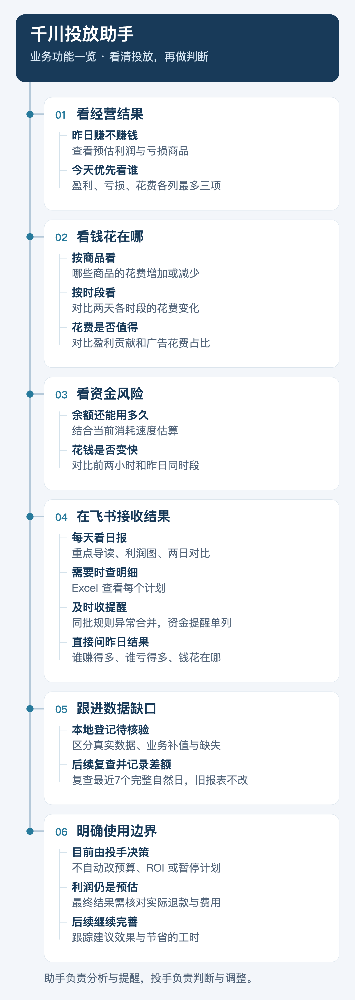
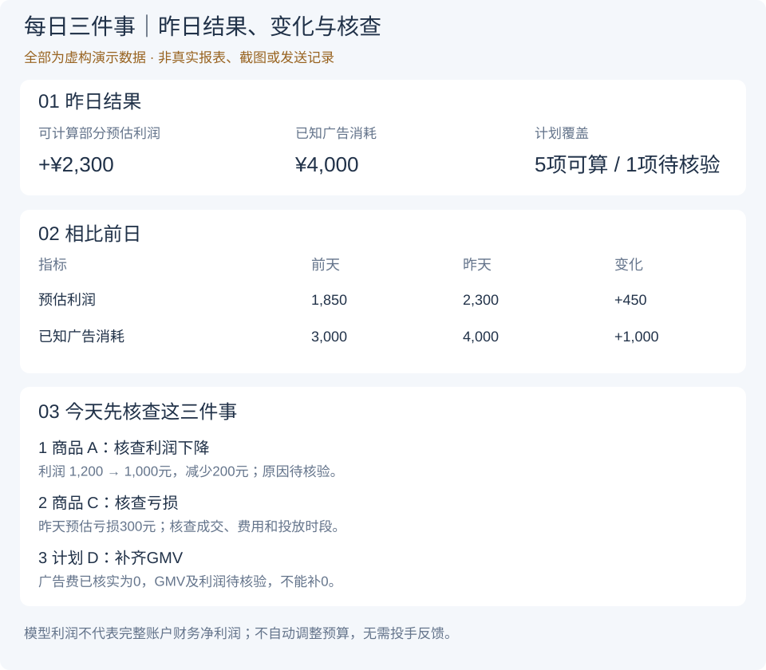
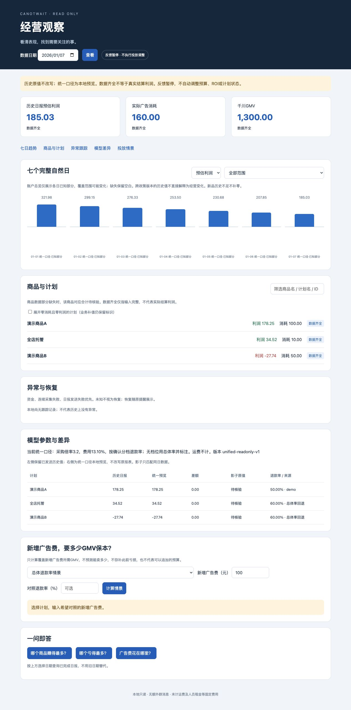

# 千川 Agent｜看清投放，再做判断

**每天少整理报表，更快看清：赚不赚钱、钱花在哪、余额够不够、今天先看什么。**

助手负责分析与提醒，投手负责决策。当前不自动改预算、ROI或暂停计划；预估利润不是最终财务利润。

## 最新进展

从看报表，进一步做到抓重点、追缺口。

| 业务难点 | 最新版本的改进 |
| --- | --- |
| 不知道先关注谁 | 盈利、亏损、花费各列最多3项，帮助确定关注顺序 |
| 查昨日表现要翻明细 | 直接问谁赚得多、谁亏得多、钱花在哪 |
| 同批异常消息太零散 | 同类型、同区间的规则异常合并，余额与退款提醒分开 |
| 数据缺失后难跟进 | 本地登记缺口，复查最近7个完整自然日并记录差额 |
| 图表和明细口径不一致 | 发送前自动核对；矛盾拦截，缺失不冒充零值 |

以上按已提交代码梳理；是否已启用、是否真实送达，仍以各环境的运行与回执记录为准。

## 现在能做什么？

| 业务问题 | 你能看到什么 |
| --- | --- |
| 赚不赚钱？ | 昨日预估利润、亏损项和重点排序 |
| 钱花在哪？ | 两天各商品、各时段花费，以及盈利贡献对比 |
| 余额够不够？ | 余额、估算可用时长和消耗速度变化 |
| 今天先查什么？ | 日报导读与异常提醒，Excel查逐计划明细 |
| 缺的数据后来补上了吗？ | 本地跟踪记录与复查差额，不额外刷群 |

## 一张图看懂业务功能

竖版阅读，手机上点击可放大。

[](docs/assets/business-tree.png)

## 日常怎么用？

| 场景 | 使用方式 |
| --- | --- |
| 每天10:00看日报 | 日期提示 → 导读 → 利润图 → Excel → 两日消耗图 → 贡献占比图 |
| 每两个小时看余额 | 偶数整点查看余额与速率；余额不高于500元时按规则预警 |
| 想快速查昨日重点 | 直接问“昨天哪个商品赚得最多”“昨天哪个亏损最多”“昨天广告费花在哪里” |
| 出现异常或缺失 | 查看具体提醒；缺失保留待核验，后续复查记录留在本地 |

时间均为北京时间，需完成本地授权与配置。日报整包只@投手一次；余额提醒独立运行，两日图不再凌晨另发。发送结果未知时先核实，避免重复发送。

## 还差什么？

| 待完善的事 | 当前边界 |
| --- | --- |
| 算清最终利润 | 还需实际退款、费用及财务数据核对 |
| 补齐所有数据 | 商品金额可按规则复查；直播明细、历史商品关联等缺口仍可能需要人工处理 |
| 验证调整有没有用 | 数据复查已加入，投手采纳与投放效果跟踪仍未完成，反馈继续暂停 |
| 开放自动操作 | 仍需单独授权和验收，当前由投手执行 |
| 证明节省多少时间、带来多少价值 | 需持续积累使用与效果记录，目前不宣称收益提升 |

**数据怎么看：**金额只汇总可计算部分；符合条件的零消耗商品计划可按业务规则补值，并明确标注，不能当作平台真实成交。商品归属未知不等于金额未知；全店托管和其他未关联计划分开看。

## 看展示模板

**全部使用虚构数据，非真实截图或发送记录。** 图片直接展示，手机上点击可放大查看。以下演示图已按最新顺序与分类规则统一，金额来自同一组虚构数据。

### ① 飞书里收到什么？｜查看完整接收流程

简短日期＋一次@投手 → 每日三件事导读图 → 利润图与Excel → 两日消耗与贡献图；余额提醒另按时段发送。

[](docs/assets/feishu-messages-template.svg)

### ② 每日三件事｜今天先核查什么？

第一张导读图展示昨日结果、前日变化，以及盈利、亏损、花费三类关注排序；缺失不参与对应排名。

[](docs/assets/daily-guide-template.svg)

### ③ 利润图｜哪些商品需要关注？

零线上方盈利、下方亏损；绿色盈利、红色亏损。待核验不填零，合计只含可计算部分。

[](docs/assets/profit-report-template.svg)

### ④ 两日消耗图｜哪些商品、哪些时段花费变了？

每组左前天、右昨天；同商品同色、刻度一致。全店托管用玫红，商品归属待核验用灰蓝，分别统计。花费增加不代表效果变好。

[](docs/assets/two-day-spend-template.svg)

### ⑤ 贡献占比图｜花钱与盈利贡献是否匹配？

左看盈利贡献，右看消耗占比。亏损、全店托管、其他未关联计划利润和缺失另列，不计入盈利饼图。

[](docs/assets/two-day-contribution-template.svg)

### ⑥ 余额提醒｜资金下降是否加快？

三时段统一刻度，估算时长假定速度不变。余额下降不是广告消耗；缺样本或资金调整时需核查。

[](docs/assets/balance-comparison-template.svg)

[演示数据与颜色对照](docs/demo-guide.md) · 商品颜色固定；余额图颜色仅代表时段。

## 继续了解

- **业务规则：** [日报与提醒](docs/automatic-profit-daily.md) · [利润计算](docs/current-profit-rules.md)
- **核验细节：** [完整性、补值与缺口跟踪](docs/report-and-verification.md)
- **项目过程：** [开发历程](docs/development-journey.md)
- **开发维护：** [开发者说明](docs/developer-guide.md) · [数据保护](SECURITY.md)

更新梳理：2026-11-09；功能依据为已提交版本 `af9cc6d`。演示图使用虚构数据，不代表生产验收结果。

### 异常回调去重与采集恢复

- 异常卡ROI显示为“区间观测ROI”：对应快照增量比值，不冒充当日累计ROI、真实订单时段或财务利润。
- 指标回调按账户、计划、指标、原始快照区间及前后值形成持久事实键，与数据可比状态变化分开。首次迁移关联历史已发送及未确认发送记录，避免升级后重报；不同计划或区间的新回调正常登记。已发历史消息和发送账本保留。
- 千川读取使用本运行目录内按应用共享的跨进程请求门控：正常完成后至少间隔0.8秒；遇40100等暂时错误共享5/10/20/40/60秒冷却并加随机抖动；网络异常共享5/10/20/30秒冷却。此为本地保守节奏，不代表平台公布额度，也不涵盖其他运行目录的客户端。
- 本地诊断记录每次尝试序号、接口类别及DNS/超时/TLS/连接错误分类；不输出凭证、请求参数、身份或异常原文。持续故障仍按原机制提示，不以零值替代失败、不屏蔽凌晨真实异常。
- 电脑Wi-Fi/AP的定时重启或换信道需网络管理员核对；本模块不修改路由器、无线网络或系统代理设置。
- 反馈继续暂停，保持dry_run，不自动调整预算、ROI或计划状态，不发送测试群消息。

### 本机只读经营看板

新增四项：统一日报与影子估算口径、异常分级与恢复跟踪、七日商品趋势与新增广告费情景、本机查询看板。

- 新模型：确认分档退款率、采购倍率3.2、费用13.10%；未计运费与固定费用，非实际结算利润。
- 历史已发报表保持原值。看板的“统一预览”另列，不覆盖原文件；模型切换的跨日比较标待核验。
- 数据齐全、含业务补值、待核验分别展示；商品部分缺失不参与该指标完整合计。账户已知部分显式标注。
- 展开商品查看计划，联查已发图片与Excel、同日影子及模型来源；日期缺失不使用旧日期代替。
- 情景模拟仅回答新增广告费需要多少GMV覆盖，不预测实际销量、不构成可执行预算。
- 异常和恢复沿用原消息通道；不增加独立群消息。反馈暂停，不自动调整预算、ROI或计划状态。

在本地运行目录配置经确认的 `data/model_policy/authority.json`（不得上传Git），然后启动：

```sh
.venv/bin/python tools/dashboard.py --root . --shadow-root /path/to/local/shadow
```

浏览器访问 `http://127.0.0.1:8768`，仅本机可用。运行配置、真实数据、人员与群信息全部留在本机。[规则说明](docs/current-profit-rules.md)包含政策版本、缺失处理、恢复和安全边界。



### 本地商品身份补充

商品名补充使用本地 `data/product_identity/confirmed.json`，不上传真实映射或证据。只有唯一商品ID、同账户计划绑定证据及商品名来源哈希通过核验才使用。历史标题明确标为“历史商品名”；缺公司款号显示“款号待核验”，不从标题、计划名或价格猜款号。
看板仅在内存中对准确数据日补充名称，不改写已发结果、图片、Excel或发送账本。后续新日报先只读复查计划绑定；变更、多商品或读取失败不套旧映射。利润图、Excel与两日图使用同一身份，保留原计划名及数值；全店托管不套商品映射。反馈继续暂停，不发独立消息，不调整预算、ROI或计划状态。

看板正常加载时隐藏顶部的汇总长提示（历史复核说明、补验证记录和固定说明），只做前端显示调整；后台证据与 API 字段继续保留，各日期的“待核验”“已复核未发送”及数据加载失败提示照常展示。隔离前端验证：`node agent-runtime/tests/dashboard_notice_test.cjs`。

### 商品名与款号标识的日报验收

下一次原有10:00自动日报在北京时间10:05后验收（本次为2026-11-10，主数据日11-09，两日对比11-08与11-09），不新建或重复触发发送。核对当次商品绑定证据，以及实际发送的导读图、利润图全部分页、Excel中的商品名和“历史商品名；款号待核验”标识一致。导读按排名展示，未入榜如实说明，不强行插入。历史报表及发送账本不改写，群历史分页回读核对一次真实@投手、附件完整与重复发送。详见[完整验收规则](docs/current-profit-rules.md#商品名与款号待核验的下一次日报验收)。只读验收，不额外发测试群消息；继续暂停反馈，不调整预算、ROI或计划状态。
