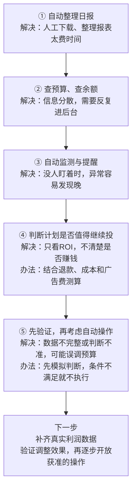

# 千川 Agent 开发历程

[返回项目首页](../README.md)

## 开发是怎样一步步推进的？

下面是业务视角的简化流程。早期数据接入和素材日报属于相关基础积累，后续逐步发展成独立的千川助手；各阶段存在交叉。

### 第一阶段：先把重复工作整理成流程

最初希望助手能整理日报、提醒余额、找出需要关注的计划，并记录投手的处理结果。

遇到的问题是，查询数据、提出建议和直接操作账户，需要的条件完全不同。因此先从只读分析做起，让人确认判断，再逐步增加能力。这一步明确了方向：先帮助投手工作，再验证哪些环节适合自动化。

### 第二阶段：接入数据，先把数字弄明白

逐步接入账户授权、广告报表、成交和素材数据。真正的难点是不同报表的统计范围、金额单位和指标口径不一致；接口没有返回记录，也不一定代表实际为零。

解决办法是把财务核对、计划表现和素材归因分开看，检查查询范围和分页完整性，并分别记录真实零值、缺失和失败。只有取得明确证据，才把相应指标认定为零，不能由“没有消耗”继续推断“没有成交”。

### 第三阶段：做出能使用的日报和飞书助手

从真实导出表开始，整理计划表现、计算预计利润，再通过飞书提供报告和查询。

这一阶段发现了部分日混入完整日、成本倍率与ROI混淆、退款可能重复扣减等问题。处理方式是逐项拆开公式：原始指标保留原值，历史假设单独说明，数据不全就标记待核验。报告开始能够支持日常讨论，但预测结果仍不能代替结算结果。

### 第四阶段：从看文件，发展到查询当前账户

接入真实日报、当前预算和账户余额，增加指定日期查询、计划诊断和业务问答。

随之遇到授权过期、接口超时、消息重复发送和账户资料串用等问题。开发补充了授权管理、有限重试、发送进度保存、访问范围限制和账户隔离；大账户保留完整数据，消息里展示摘要，避免一次返回过多内容。

### 第五阶段：让助手持续工作，并能发现自身异常

增加定时快照、小时报表、余额监测、异常记录和健康检查。

持续运行后发现，程序还开着不代表采集正常，两次累计数字的差值也不一定就是这段时间真实发生的业务。因此开始检查数据更新时间、采集进度和时间范围，并补充日志、升级核验与回滚能力。历史部署和采集已有证据，长期稳定性仍需持续观察。

### 第六阶段：把投手经验变成明确条件

“这个计划不错，可以考虑加预算”需要进一步拆解：看几天、怎样算盈利、数据缺失怎么办、余额不足怎么办、刚调整过是否还能再调？

项目逐步整理了盈利质量、观察周期、余额保护、调整间隔和审批等条件。代码负责计算与检查，大模型负责解释和复盘，不能自行更改业务阈值。规则与执行组件的实现，为后续受控操作做准备，不代表当前已开放自动投放。

### 第七阶段：用真实数据做影子验证

“影子验证”就是先让系统跑判断，记录它会建议什么、为什么，再检查能否用于真实操作。

实际发现了历史缺行、成交与订单修订、查询指标不同导致返回记录不同等问题。通过补采、对账、修订审核和证据回放逐项处理；不满足条件时保留阻断原因。一个计划通过盈利检查，也不代表所有操作条件都已满足。

### 第八阶段：补利润分析、反馈记录和规范交付

利润分析逐渐发展为两条独立路径：一条使用千川计划数据和已确认的业务假设进行情景估算；另一条保留订单、退款及成本导入核算。两者不混算。实际广告费与按比例估算广告费也分别计算，避免重复扣费。

同时补充了建议编号、投手反馈和只读预算核验，并整理脱敏代码、测试与交接说明。反馈功能当前暂停交互，完整的效果回收仍待完善。代码备份与本地运行配置分开管理，方便维护，也避免把真实经营资料带入仓库。

## 最新进展：日报与余额提醒更直观

2026-11-06核对的版本已补充自动利润日报、指定日期图片回复、手机摘要及余额三时段对比。发送流程增加分段回读和附件校验，详细状态见[首页](../README.md)和[自动日报说明](automatic-profit-daily.md)。这些能力依赖本地配置和授权，不能把代码交付视为所有环境均已启用。
