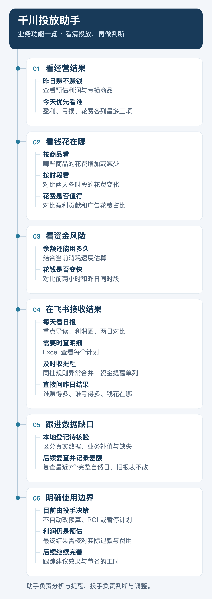
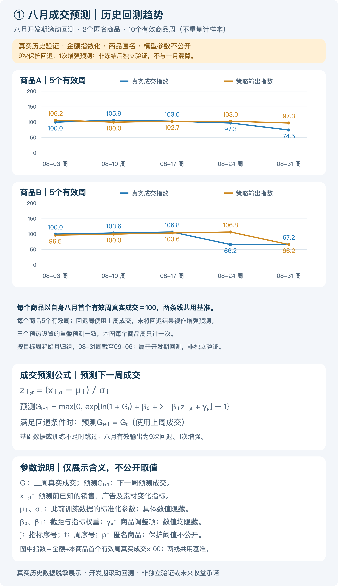
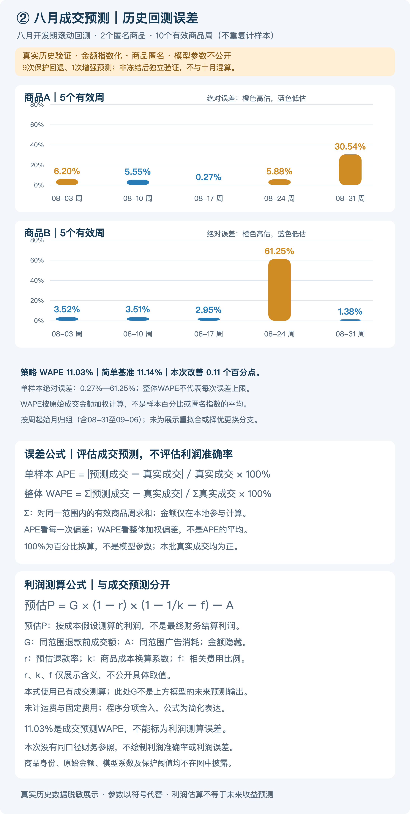
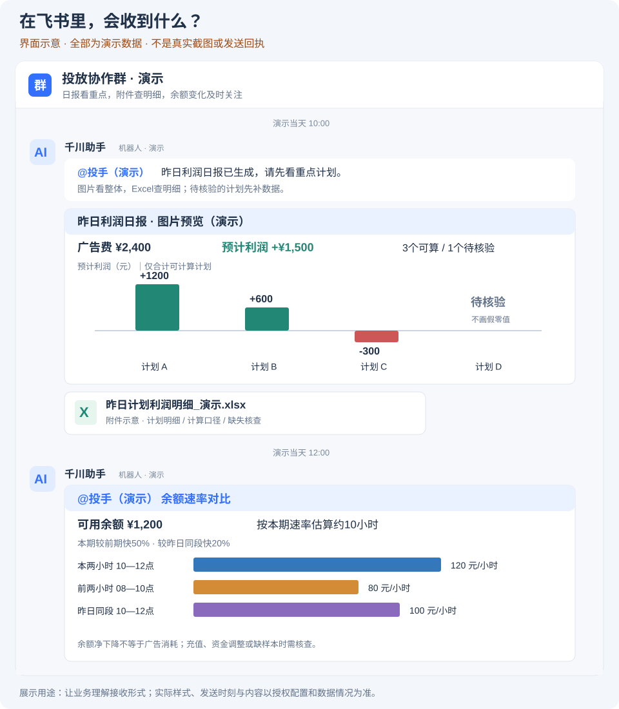
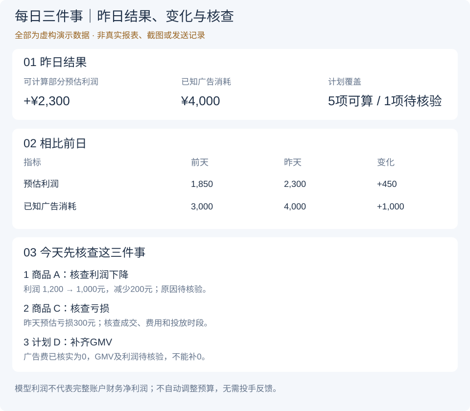
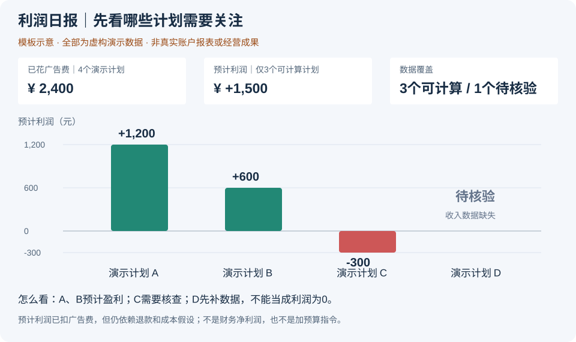
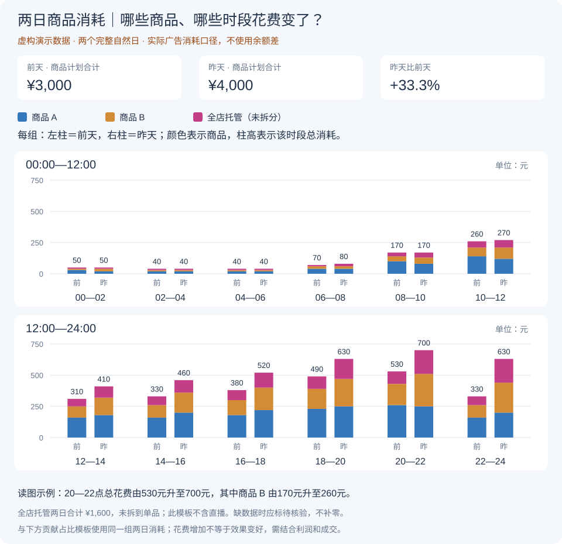
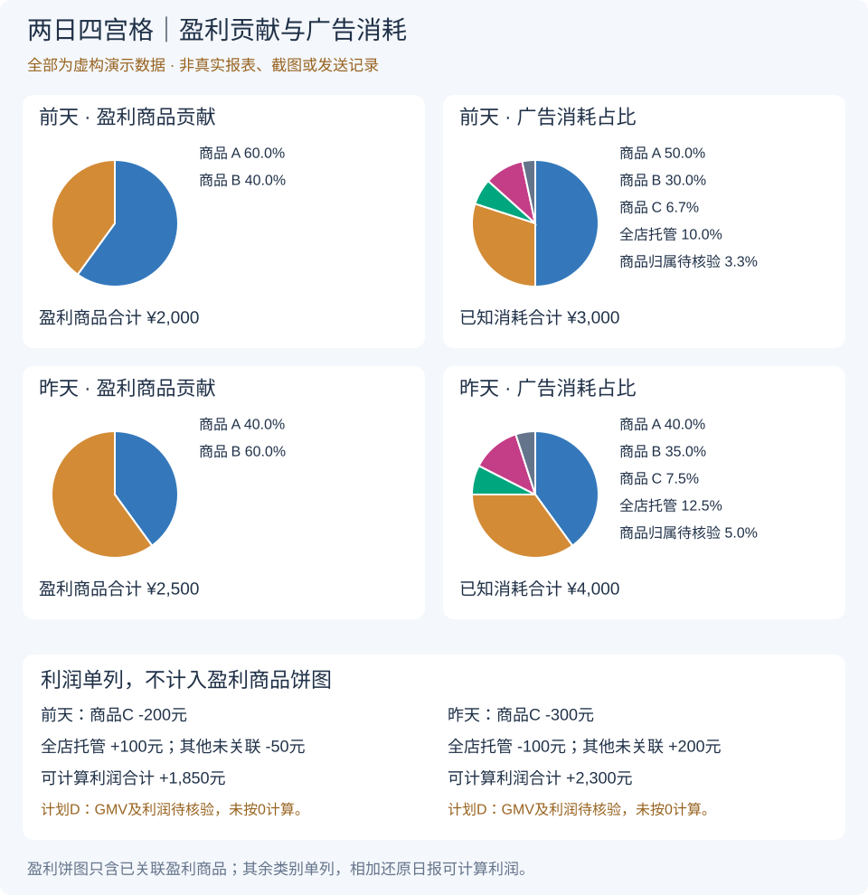
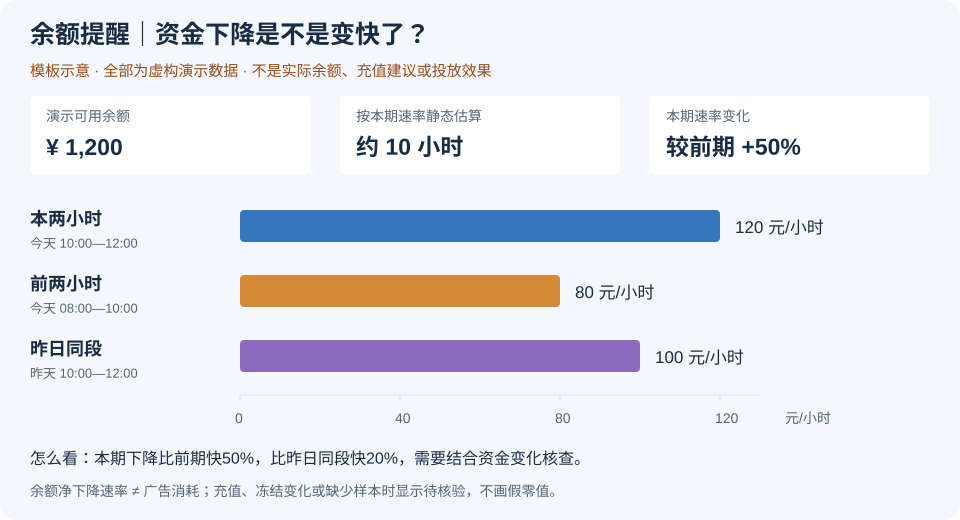
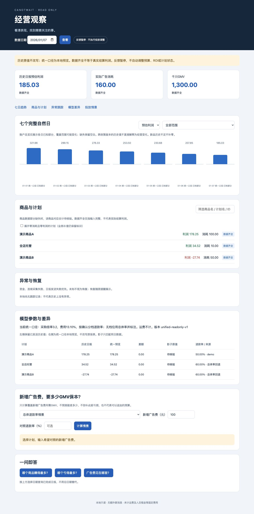

[返回精简首页](../README.md)

# 千川 Agent｜看清投放，再做判断

**简体中文** · [English](../README.en.md)

**每天少整理报表，更快看清：赚不赚钱、钱花在哪、余额够不够、今天先看什么。**

助手负责分析与提醒，投手负责决策。当前不自动改预算、ROI或暂停计划；预估利润不是最终财务利润。

## 最新进展

从看报表，进一步做到抓重点、追缺口。

| 业务难点 | 最新版本的改进 |
| --- | --- |
| 不知道先关注谁 | 盈利、亏损、花费各列最多3项，帮助确定关注顺序 |
| 查昨日表现要翻明细 | 直接问谁赚得多、谁亏得多、钱花在哪 |
| 同批异常消息太零散 | 同类型、同区间的规则异常合并，余额与退款提醒分开 |
| 数据缺失后难跟进 | 本地登记缺口，复查最近7个完整自然日并记录差额 |
| 图表和明细口径不一致 | 发送前自动核对；矛盾拦截，缺失不冒充零值 |

以上按已提交代码梳理；是否已启用、是否真实送达，仍以各环境的运行与回执记录为准。

## 现在能做什么？

| 业务问题 | 你能看到什么 |
| --- | --- |
| 赚不赚钱？ | 昨日预估利润、亏损项和重点排序 |
| 钱花在哪？ | 两天各商品、各时段花费，以及盈利贡献对比 |
| 余额够不够？ | 余额、估算可用时长和消耗速度变化 |
| 今天先查什么？ | 日报导读与异常提醒，Excel查逐计划明细 |
| 缺的数据后来补上了吗？ | 本地跟踪记录与复查差额，不额外刷群 |

## 一张图看懂业务功能

竖版阅读，手机上点击可放大。

[](assets/business-tree.png)

## 日常怎么用？

| 场景 | 使用方式 |
| --- | --- |
| 每天10:00看日报 | 日期提示 → 导读 → 利润图 → Excel → 两日消耗图 → 贡献占比图 |
| 每两个小时看余额 | 偶数整点查看余额与速率；余额不高于500元时按规则预警 |
| 想快速查昨日重点 | 直接问“昨天哪个商品赚得最多”“昨天哪个亏损最多”“昨天广告费花在哪里” |
| 出现异常或缺失 | 查看具体提醒；缺失保留待核验，后续复查记录留在本地 |

时间均为北京时间，需完成本地授权与配置。日报整包只@投手一次；余额提醒独立运行，两日图不再凌晨另发。发送结果未知时先核实，避免重复发送。

## 还差什么？

| 待完善的事 | 当前边界 |
| --- | --- |
| 算清最终利润 | 还需实际退款、费用及财务数据核对 |
| 补齐所有数据 | 商品金额可按规则复查；直播明细、历史商品关联等缺口仍可能需要人工处理 |
| 验证调整有没有用 | 数据复查已加入，投手采纳与投放效果跟踪仍未完成，反馈继续暂停 |
| 开放自动操作 | 仍需单独授权和验收，当前由投手执行 |
| 证明节省多少时间、带来多少价值 | 需持续积累使用与效果记录，目前不宣称收益提升 |

**数据怎么看：**金额只汇总可计算部分；符合条件的零消耗商品计划可按业务规则补值，并明确标注，不能当作平台真实成交。商品归属未知不等于金额未知；全店托管和其他未关联计划分开看。

## 成交预测与利润测算｜脱敏参考

**以下两张图来自真实历史回测的脱敏结果，不是虚构演示。** 商品匿名、金额转为指数，公式只公开结构与参数含义，具体系数、费率和保护阈值不公开。

| 八月参考范围 | 结果 |
| --- | --- |
| 样本 | 2个商品、10个有效商品周 |
| 策略整体误差（WAPE） | 11.03%；简单基准11.14%，改善约0.11个百分点 |
| 单样本误差（APE） | 0.27%—61.25% |
| 输出方式 | 9次保护回退、1次增强预测 |

按目标周起始月归组，包含08-31至09-06这一周。八月是比较已有月份后选取的展示窗口，属于开发期滚动回测，**不是冻结后独立验证，也不是未来误差保证**。11.03%仅对应成交预测，不代表利润测算误差。

### 成交趋势与预测公式

[](assets/august-forecast-formula-sanitized.png)

### 误差与利润测算公式

[](assets/august-error-profit-formula-sanitized.png)

[查看全部脱敏公式、参数说明与判断条件](model-rules-sanitized.md)。基础数据或训练条件不足时跳过；只有满足回退条件时才采用上周成交。利润测算与成交预测分别解释，不自动调整投放。

## 看展示模板

**全部使用虚构数据，非真实截图或发送记录。** 图片直接展示，手机上点击可放大查看。以下演示图已按最新顺序与分类规则统一，金额来自同一组虚构数据。

### ① 飞书里收到什么？｜查看完整接收流程

简短日期＋一次@投手 → 每日三件事导读图 → 利润图与Excel → 两日消耗与贡献图；余额提醒另按时段发送。

[](assets/feishu-messages-template.svg)

### ② 每日三件事｜今天先核查什么？

第一张导读图展示昨日结果、前日变化，以及盈利、亏损、花费三类关注排序；缺失不参与对应排名。

[](assets/daily-guide-template.svg)

### ③ 利润图｜哪些商品需要关注？

零线上方盈利、下方亏损；绿色盈利、红色亏损。待核验不填零，合计只含可计算部分。

[](assets/profit-report-template.svg)

### ④ 两日消耗图｜哪些商品、哪些时段花费变了？

每组左前天、右昨天；同商品同色、刻度一致。全店托管用玫红，商品归属待核验用灰蓝，分别统计。花费增加不代表效果变好。

[](assets/two-day-spend-template.svg)

### ⑤ 贡献占比图｜花钱与盈利贡献是否匹配？

左看盈利贡献，右看消耗占比。亏损、全店托管、其他未关联计划利润和缺失另列，不计入盈利饼图。

[](assets/two-day-contribution-template.svg)

### ⑥ 余额提醒｜资金下降是否加快？

三时段统一刻度，估算时长假定速度不变。余额下降不是广告消耗；缺样本或资金调整时需核查。

[](assets/balance-comparison-template.svg)

[演示数据与颜色对照](demo-guide.md) · 商品颜色固定；余额图颜色仅代表时段。

## 继续了解

- **业务规则：** [日报与提醒](automatic-profit-daily.md) · [利润计算](current-profit-rules.md)
- **核验细节：** [完整性、补值与缺口跟踪](report-and-verification.md)
- **项目过程：** [开发历程](development-journey.md)
- **开发维护：** [开发者说明](developer-guide.md) · [数据保护](../SECURITY.md)

更新梳理：2026-11-09；功能依据为已提交版本 `309a819`。演示图使用虚构数据，不代表生产验收结果。

### 异常回调去重与采集恢复

- 异常卡ROI显示为“区间观测ROI”：对应快照增量比值，不冒充当日累计ROI、真实订单时段或财务利润。
- 指标回调按账户、计划、指标、原始快照区间及前后值形成持久事实键，与数据可比状态变化分开。首次迁移关联历史已发送及未确认发送记录，避免升级后重报；不同计划或区间的新回调正常登记。已发历史消息和发送账本保留。
- 千川读取使用本运行目录内按应用共享的跨进程请求门控：正常完成后至少间隔0.8秒；遇40100等暂时错误共享5/10/20/40/60秒冷却并加随机抖动；网络异常共享5/10/20/30秒冷却。此为本地保守节奏，不代表平台公布额度，也不涵盖其他运行目录的客户端。
- 本地诊断记录每次尝试序号、接口类别及DNS/超时/TLS/连接错误分类；不输出凭证、请求参数、身份或异常原文。持续故障仍按原机制提示，不以零值替代失败、不屏蔽凌晨真实异常。
- 电脑Wi-Fi/AP的定时重启或换信道需网络管理员核对；本模块不修改路由器、无线网络或系统代理设置。
- 反馈继续暂停，保持dry_run，不自动调整预算、ROI或计划状态，不发送测试群消息。

### 本机只读经营看板

新增四项：统一日报与影子估算口径、异常分级与恢复跟踪、七日商品趋势与新增广告费情景、本机查询看板。

- 新模型：确认分档退款率、采购倍率3.2、费用13.10%；未计运费与固定费用，非实际结算利润。
- 历史已发报表保持原值。看板的“统一预览”另列，不覆盖原文件；模型切换的跨日比较标待核验。
- 数据齐全、含业务补值、待核验分别展示；商品部分缺失不参与该指标完整合计。账户已知部分显式标注。
- 展开商品查看计划，联查已发图片与Excel、同日影子及模型来源；日期缺失不使用旧日期代替。
- 情景模拟仅回答新增广告费需要多少GMV覆盖，不预测实际销量、不构成可执行预算。
- 异常和恢复沿用原消息通道；不增加独立群消息。反馈暂停，不自动调整预算、ROI或计划状态。

在本地运行目录配置经确认的 `data/model_policy/authority.json`（不得上传Git），然后启动：

```sh
.venv/bin/python tools/dashboard.py --root . --shadow-root /path/to/local/shadow
```

浏览器访问 `http://127.0.0.1:8768`，仅本机可用。运行配置、真实数据、人员与群信息全部留在本机。[规则说明](current-profit-rules.md)包含政策版本、缺失处理、恢复和安全边界。



### 本地商品身份补充

商品名补充使用本地 `data/product_identity/confirmed.json`，不上传真实映射或证据。只有唯一商品ID、同账户计划绑定证据及商品名来源哈希通过核验才使用。历史标题明确标为“历史商品名”；缺公司款号显示“款号待核验”，不从标题、计划名或价格猜款号。
看板仅在内存中对准确数据日补充名称，不改写已发结果、图片、Excel或发送账本。后续新日报先只读复查计划绑定；变更、多商品或读取失败不套旧映射。利润图、Excel与两日图使用同一身份，保留原计划名及数值；全店托管不套商品映射。反馈继续暂停，不发独立消息，不调整预算、ROI或计划状态。

看板正常加载时隐藏顶部的汇总长提示（历史复核说明、补验证记录和固定说明），只做前端显示调整；后台证据与 API 字段继续保留，各日期的“待核验”“已复核未发送”及数据加载失败提示照常展示。隔离前端验证：`node agent-runtime/tests/dashboard_notice_test.cjs`。

### 商品名与款号标识的日报验收

下一次原有10:00自动日报在北京时间10:05后验收（本次为2026-11-10，主数据日11-09，两日对比11-08与11-09），不新建或重复触发发送。核对当次商品绑定证据，以及实际发送的导读图、利润图全部分页、Excel中的商品名和“历史商品名；款号待核验”标识一致。导读按排名展示，未入榜如实说明，不强行插入。历史报表及发送账本不改写，群历史分页回读核对一次真实@投手、附件完整与重复发送。详见[完整验收规则](current-profit-rules.md#商品名与款号待核验的下一次日报验收)。只读验收，不额外发测试群消息；继续暂停反馈，不调整预算、ROI或计划状态。

### 单商品计划映射与未关联项

商品映射不依赖是否有小时消耗记录：零消耗计划也可通过同账户、同数据日的原始计划列表确认唯一商品ID与商品名。看板使用各数据日的证据补充显示；新日报复用当次列表，避免为批量计划额外逐个请求详情。缺公司款号仍显示“款号待核验”。
多商品计划缺商品级成交、消耗和分摊证据时保留计划口径；直播未返回商品列表或绑定明细时保留归属待核验，不指定为单一商品、不混入全店托管。真实映射和逐项缺失清单仅存本地，仓库仅含通用实现与虚构测试。详见[商品映射规则](current-profit-rules.md#单商品列表证据与剩余待核验项)。

下一次日报的商品映射验收已扩展至本批补充的单商品计划及剩余的多商品、直播两类待核验项，与原测试计划合并在同一验收任务内，不重复安排发送。以当次实际计划及分页证据统计覆盖，不把本批登记数量当作明日固定覆盖数；导读、利润图和Excel中的同计划商品名一致，缺款号仍标待核验，多商品与直播不强行归属。参见[扩展验收要求](current-profit-rules.md#批量商品映射与剩余待核验项的扩展验收)。

多商品计划支持计划内GMV/消耗补充明细：日报图片补充页及Excel展示真实返回与待核验原因；计划合计只计一次，不将商品明细再次汇入利润或排名。历史补采只读展示，后续日报按当日绑定重新采集；缺商品日和直播绑定均不推测补零。详见项目利润规则。

### 商品级补充明细的日报验收

此项并入既有下一次10:00日报验收，按当次数据日核对商品绑定、GMV、广告消耗、缺失原因及款号待核验标识，不将历史补采数量或旧日记录当作当日覆盖。计划合计只计一次，商品明细不重复计入利润、排名或饼图分母；日报补充图片页与Excel逐项一致，补充页属于原利润图分页，位于Excel之前，不另发通知或重复@。保留历史报表及已复核未发送状态。详见[商品级明细验收规则](current-profit-rules.md#商品级补充明细的日报验收)。

已确认退款口径差异按指标核验：商品计划广告消耗独立核对后正常显示，利润贡献沿用对应日原日报，不把GMV差异再次扣成利润损失。直播及其他缺失单列待核验，不因单项已确认差异隐藏整日图表；未确认矛盾仍受发送前体检拦截。

### 退款差异分指标展示的日报验收

此项并入既有下一次10:00日报验收：按当次日期精确匹配有效退款确认，分别核验消耗与原日报利润的展示依据。已确认差异不遮挡可核实图表，缺失单列，不重复扣减退款；图片与对应日期Excel按同一范围一致。没有实际退款差异时仅隔离测试，不制造生产事件或群消息。保留历史报表及未发送状态，继续暂停反馈，不调整投放。详见[分指标展示验收规则](current-profit-rules.md#退款差异分指标展示的日报验收)。

### 看板折叠说明与名称展示

- 金额与状态、七日趋势、商品与计划、利润测算对比、投放情景、一问即答均提供“怎么看”，默认收起，支持键盘展开；不遮挡或替代数据及缺失标识。
- “商品与计划”隐藏明确为 LIVE_PROM_GOODS 的直播计划组，仅影响该区显示；不按名称猜测直播，不删除源数据，不修改账户合计、历史报表或直播投放。
- 商品名称和补充明细不再展示“款号待核验”文案，底层缺失记录仍保留；“归属待核验”和金额缺失提示不删除，不伪造款号。下载的历史附件保持原样。
- “退款率 / 来源”改称“退款率 / 取值依据”，用中文展示已确认价格档、总体率及未匹配档位时采用总体率的情况；该参数不是当天实际退款率。
- 仅有旧文字日报、缺逐计划报表或政策的历史日期继续待核验，不补零。本说明不得硬编码真实日期、金额、商品映射或核验证据。
- 静态页面部署前备份，隔离渲染测试不访问网络、不发送群消息；保留配置、数据和历史报表，反馈暂停，不调整预算、ROI或计划状态。
- 验证命令：`node agent-runtime/tests/dashboard_help_test.cjs` 与 `node agent-runtime/tests/dashboard_notice_test.cjs`。

### 业务版经营观察：简称、历史补采与回答排版

- 商品以原名中的系列、辨识特征和品类生成展示简称，不重新识别商品；悬停保留完整名称，搜索兼容原名与简称。简称重复时追加稳定区分标记，不合并不同商品或计划。原始名称、映射、金额及历史附件不改写。
- 经营观察面向投手和业务负责人，移除“异常与恢复”板块及入口，后台异常监测保留。“模型参数与差异”改称“利润测算对比”，不展示技术版本号；原“统一预览”“影子原值”分别显示为“当前口径测算”“对照测算”。
- 利润对比及其共用情景选项依据计划身份匹配明确的 LIVE_PROM_GOODS 类型后隐藏直播记录，不按名称猜测，不改变原始数据、利润计算或实际投放状态。
- 历史补采须显式开启商品范围，只读查询早于采集当天的完整自然日；普通自动日报仍限昨日。沿用分页、日期、独立汇总与零消耗GMV复查规则，不查询直播。失败或缺失不得冒充真实零值。
- 本地补采结果独立保存，按账户、日期、商品范围及文件哈希校验后作为看板缺失日期的后备来源，已完成原日报优先。趋势、日期总览与回答标明“补采测算”“不含直播”“未发送”；采用本次确认政策，不能冒充当时已发日报或财务结算利润。
- 补采索引位于本地 `data/dashboard_backfills/`，原始响应与结果位于 `out/dashboard_backfills/`，均不得上传。索引绑定的文件变化、范围不符或证据缺失时保持待核验，不改写发送账本、历史报表或确认发送状态。
- 一问即答使用黑色文字，每条排名及说明分行，数据日期置于回答最底部；缺失、业务补值与预算边界提示保留。文本采用 DOM textContent 展示，不执行返回内容中的 HTML。
- 验证仅使用虚构账户、商品、日期和金额以及 mock API；覆盖只读范围、哈希变化拒绝、直播排除、显示不改数据、折叠说明、商品简称及回答日期顺序。
- 本次能力不新增群消息，不恢复反馈，不调整预算、ROI或计划状态。真实补采记录、配置和人员信息始终仅留本地。

### 经营看板移除计划内商品明细

经营看板不再展示“计划内商品明细”区块及其说明，不创建或调用该区块的前端渲染。计划整体GMV、广告消耗、预估利润及现有合计口径保留；后台商品明细、缺失原因和接口数据继续保留。此调整仅限看板展示，不删除采集结果，不改写历史报表，也不改变日报商品补充页或Excel。

回归验证须覆盖区块不存在、页面加载不访问已移除节点、计划数据及后台明细不被渲染修改，其他缺失与复核状态正常保留。反馈继续暂停，不新增群消息，不调整预算、ROI或计划状态。提交仅包含通用代码、规则和虚构测试数据，不包含真实明细、备份、配置或群聊人员信息。

#### 纳入既有自动日报验收

- 在已安排的下一次北京时间10:00日报发送后、10:05起验收，主日报使用昨日、两日图使用前两个完整自然日；沿用原任务，不新增或重复触发日报。
- 只读确认正式看板已移除计划内商品明细区块、页面正常加载，计划整体GMV、广告消耗、预估利润和合计口径保留。后台 `product_breakdowns`、`product_binding_pending`、原始明细及缺失原因仍保留；看板移除不代表停止采集或删除明细。
- 原日报仍按日期提示与一次真实@投手、导读图、利润图全部分页、当日商品补充页、Excel、两日消耗图、四宫格顺序核验。商品明细只解释父计划，不重复计入账户合计、利润或排名；看板调整不得造成日报附件遗漏、数据变化或额外消息。
- 对照本地已有历史哈希基线核验历史报表及发送账本未改写，原有复核利润、仅已知部分提示及“已复核未发送”状态保留；具体日期、金额和核验证据仅在本地任务中记录，不写入仓库。历史API备份仅辅助比较相同日期展示，不替代当次日报来源。
- 沿用实际群历史完整分页、附件回读、原生mentions及重复发送核验。发送未知先回读，不盲目重发，不额外发测试群消息；发现问题先备份再修复和隔离测试，不覆盖已发历史报表。
- 继续暂停反馈，保持dry_run，不调整预算、ROI或计划状态。仅完成、发现问题或需要处理时报告，完成后结束本次临时验收，保留常驻调度。文档同步前备份，仅同步文档，不修改配置、数据或重启服务。

### 商品近7天盈亏与历史绑定补核验

- 点击商品行展开截至所选数据日的近7天预估盈亏折线图，保留下方计划数据。按稳定商品或分组身份匹配，不按简称合并。全店托管与未关联计划独立展示。
- 盈利绿点、亏损红点，逐日金额及零基线保留。缺失断线并标待核验，不补0、不跨缺失连线；真实0正常展示。补采测算、复核未发送及业务补值提示保留，不将测算依据变化误称实际经营原因。
- 历史计划盈亏存在但商品身份未匹配时，核对留存的同账户、同自然日、同计划请求、成功状态、完整分页、唯一商品与证据哈希。当前绑定或相似名称不足以确认历史归属；无法确认时保留计划口径，说明已有计划盈亏、缺历史商品归属证据。
- 按既有历史日期补采列表规则确认后，仅补充本地对应日期绑定，复用只读overlay；标明补采测算，不冒充当日原始快照或结算利润。不改原利润、已发报表、附件、发送账本或原始补采文件，不将单日绑定套用其他日期。账户/日期/商品冲突、多商品或哈希失效不得套用。
- 虚构测试覆盖身份匹配、缺失与真实零、负利润、复核与补值提示、日期及账户隔离、多商品拒绝、哈希失效和原报告不变。真实映射、核验证据、配置、群聊人员信息仅留本地。修改前备份，测试后更新，继续暂停反馈，不发群、不调整预算、ROI或计划状态。
