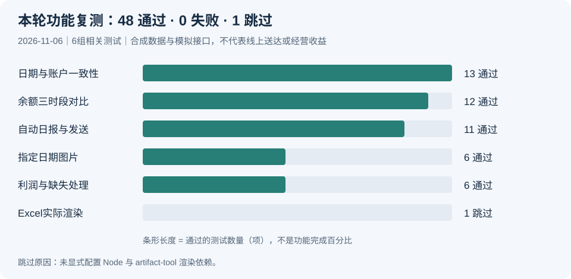

# 首页能力核查与复测记录

日期：2026-11-06。核查代码基线：`cd8bb59`。仅更新项目说明与图示，不部署服务、不读取真实经营报表、不发送群消息、不改投放。

## 核查依据

| 能力 | 主要代码/说明依据 |
| --- | --- |
| 自动利润日报及发送验证 | `agent-runtime/agent/profit_daily.py`、`profit_delivery.py`；`docs/automatic-profit-daily.md` |
| 指定日期与账户隔离 | `agent-runtime/agent/profit_analysis.py`、`manual_profit.py`、`generation.py` |
| 简洁手机图片 | `agent-runtime/agent/profit_summary.py`；自动日报说明中的简洁图片段落 |
| 余额三时段比较 | `agent-runtime/agent/balance_comparison.py`；自动日报说明中的三时段段落 |
| 利润与缺失处理 | `agent-runtime/agent/plan_profit.py`；`docs/current-profit-rules.md` |
| 原5项失败修复 | `7bed176`及`SECURITY.md`历史回归记录；本轮未重新执行这5项 |

## 本轮复测

在独立脱敏仓库的`agent-runtime/`中，以Python 3.9.6执行以下unittest模块。使用合成数据、临时目录和模拟接口。未使用生产服务环境；项目推荐Python 3.12+，本结果不替代目标环境验收。

| 测试模块 | 运行 | 通过 | 失败/错误 | 跳过 |
| --- | ---: | ---: | ---: | ---: |
| tests.test_profit_daily | 11 | 11 | 0 | 0 |
| tests.test_profit_analysis | 13 | 13 | 0 | 0 |
| tests.test_generation_images | 6 | 6 | 0 | 0 |
| tests.test_balance_comparison | 12 | 12 | 0 | 0 |
| tests.test_plan_profit | 6 | 6 | 0 | 0 |
| tests.test_profit_excel | 1 | 0 | 0 | 1 |
| **合计** | **49** | **48** | **0** | **1** |

复测命令（从`agent-runtime/`运行）：

```sh
python3 -m unittest tests.test_profit_daily tests.test_profit_analysis tests.test_generation_images tests.test_balance_comparison tests.test_plan_profit tests.test_profit_excel
```

Excel专项需要显式设置`QC_TEST_NODE`并提供`artifact-tool`，本轮未配置，按测试规则跳过。环境出现urllib3与系统LibreSSL兼容警告；本轮使用模拟接口，不证明真实网络调用兼容。手机图片与余额图真实字体/渲染效果未在本轮重新验收。

验证统计图仅展示上述测试数量，不是项目完成率、线上成功率或业务收益。本轮未执行全量回归，也未重新核验生产送达回执。首页的已实现状态来自当前代码、规则说明及对应测试，不将其写成所有环境都已启用。

## 仍然有效的边界

- 当前业务流程不自动改预算、ROI或计划状态。
- 反馈交互当前暂停，效果回收尚未闭环。
- 利润是情景估算，缺少财务结算和全部成本闭环。
- 余额下降速率不是广告财务消耗；缺失不补零。
- 自动发送需要本地明确启用和授权，克隆仓库不会自动启用。

## 验证统计图（技术查阅）



## 首页演示图说明

首页利润和余额模板均为静态SVG、虚构计划和演示数据，不使用生产图或真实金额。演示利润分别为1200、600、-300和未知；余额速率分别为120、80、100元/小时，可用余额1200元，静态估算10小时。示例用于说明图表阅读方式，不作为系统自动操作或经营收益的证据。

## 飞书接收展示模板

新增`assets/feishu-messages-template.svg`，以简化群聊示意展示日报文字、利润图片、Excel附件和余额图片提醒。群与人员均为虚构名称，数字沿用既有演示模板。不是真实截图、附件下载入口或发送回执；没有发送群消息或改动生产配置。

## 业务阅读体验优化

首页合并重复的能力与问题表，先展示飞书使用效果，再展示利润、余额两类报告。图中保留演示标识，增加图片打开入口；技术步骤迁移到developer-guide.md，项目构成折叠展示，开发历程保留独立页面。无功能、配置或部署改动。

## 演示数据统一修正（覆盖此前模板数字）

发现单独利润图仍为旧数值，且商品 C亏损未计入消耗图。本次统一：前天A/B/C/托管消耗1500/900/200/400，昨天1600/1400/300/700；前天A/B/C利润1200/800/-200，昨天1000/1500/-300，托管利润均未知。昨天盈利合计2500，可计算净额2200；蓝A、橙B、绿C、玫红托管。利润柱以位置表示盈亏，颜色表示商品。余额数据保持120/80/100元每小时、余额1200元与估算10小时；颜色表示时段。

`../scripts/refresh_demo_consistency.py`仅处理虚构演示图，不读取生产数据。飞书示意以内嵌SVG复用单独图表，避免另写缩略图造成数字漂移。此前章节数字是历史版本，不再适用于当前首页。
